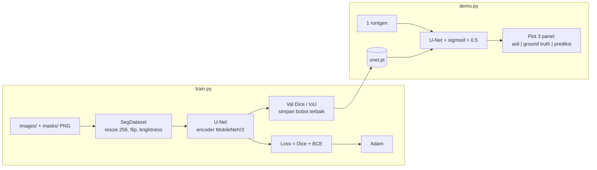

# Arsitektur

| File | Peran |
|---|---|
| `src/dataset.py` | pasangan gambar/mask + augmentasi |
| `src/unet_model.py` | pembuat model, metrik Dice/IoU |
| `train.py` | training dan validasi |
| `demo.py` | inference + plot |
